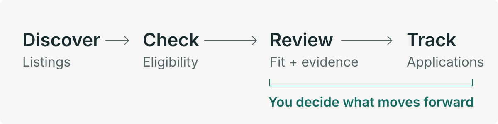

# PairRole

**From scattered listings to informed applications.**

A personal job-search workspace that discovers roles, evaluates them against CV evidence, and tracks applications through interview preparation. I built it to connect the search process with the decisions and documents that follow.

This public portfolio copy uses synthetic candidate evidence and contains no live
credentials or CVs. Discovery and summary Actions run manually after a user
configures their own private database and environment secrets.

**Python · TypeScript · Streamlit · Supabase/PostgreSQL · OpenAI API · GitHub Actions**

[Engineering decisions](#engineering-decisions) · [Run locally](#run-locally) · [Technical guide](docs/technical-guide.md)

## The workflow

<p>
  
</p>

1. **Discover and check.** Search job portals and company hiring boards, merge duplicate listings, enrich descriptions, and flag unresolved location, language, or availability questions.
2. **Evaluate with evidence.** Rate selected jobs against a structured candidate profile, with separate fit, evidence coverage, confidence, and gap information.
3. **Prepare and track.** Tailor a CV, review its changes, export a PDF, track application stages, and save interview preparation with the relevant source context. Recurring skill gaps inform improvement recommendations.

## Engineering decisions

The central design constraint: **a skill mentioned on a CV is not proof of professional experience.** The [candidate evidence model](matching/candidate_profile.py) enforces that distinction, and [regression tests](tests/test_candidate_profile.py) check that fundamentals cannot become production ownership.

- **Separate acquisition from AI.** The [TypeScript discovery pipeline](tools/generic_discovery.ts) collects and checks listings independently of OpenAI. Users initiate evaluation; the app does not submit applications.
- **Treat incomplete data explicitly.** [ATS ingestion](tools/ats_job_ingestor.ts) distinguishes complete snapshots from partial or failed crawls, so a failed search is not evidence that a job has closed.
- **Preserve decision context.** Assessments retain profile-version context, while [interview preparation](docs/interview-prep-phase1.md) preserves source snapshots and submitted-CV provenance.
- **Control read volume.** [Dashboard summaries](ui/dashboard_summary.py) support paginated reads and on-demand details. [Request metrics](scripts/postgrest_egress_report.py) help inspect response volume without logging response content.
- **Sandbox generated documents.** [LaTeX compilation](matching/latex_sandbox.py) uses network isolation and resource limits, and fails closed when the sandbox is unavailable.

## Security

CI runs secret and dependency scans, SSRF and HTTP privacy regressions,
document sandbox policy and fail-closed checks, disposable-Postgres authorization
tests, CodeQL, and pull-request dependency review. Four real Bubblewrap/TeX
compiler tests run on a trusted local host because GitHub-hosted runners deny
the required namespace setup. Offline
AI safeguard tests check structured output, explicit interview-pack consent, and
prohibited side effects; they do not claim prompt-injection resistance or model
accuracy. See the [security implementation and evidence](docs/security-implementation-plan.md)
and [threat model](docs/security-threat-model.md) for controls and residual
risks. The app has no login, so deployment ingress must remain private. Report
vulnerabilities through the [security policy](SECURITY.md).

## Inside the project

Streamlit provides the workspace; Python handles candidate evidence, matching, and CV workflows. TypeScript and Bun run discovery. Supabase persists listings, decisions, and assessments, with generated documents in private storage. GitHub Actions invokes the same discovery launcher used locally.

| Explore | Code |
| --- | --- |
| App and review workflows | [`app.py`](app.py) · [`ui/`](ui/) |
| Candidate evidence and AI evaluation | [`matching/`](matching/) |
| Discovery and source adapters | [`tools/`](tools/) · [`.agents/skills/`](.agents/skills/) |
| Database migrations | [`supabase/migrations/`](supabase/migrations/) |
| Python and TypeScript regression tests | [`tests/`](tests/) |

## Run locally

Use Python 3.12 (recommended), Bun for discovery, and a configured Supabase project with the repository's migrations applied. Set your project credentials and user UUID in `.env`; AI features also require an OpenAI API key.

```bash
python3 -m venv .venv
source .venv/bin/activate
pip install -r requirements.txt
cp .env.example .env
# Configure .env before starting.
streamlit run app.py
```

See the [technical guide](docs/technical-guide.md) for configuration and manual discovery. PDF generation requires Linux, TeX, and the [document sandbox dependencies](docs/cv-artifact-safety.md).

<details>
<summary><strong>Run the tests</strong></summary>

```bash
pip install -r requirements-dev.txt
pytest -q
bun test tests
```

Some integration checks require local sandbox dependencies. Source-specific CLI setup lives under `.agents/skills/<source>/cli/`.

</details>

**Scope:** A personal, server-configured app with no credential-free demo. Source availability depends on the provider, profile, and credentials; AI outputs need review. Keep credentials, CVs, and generated application documents outside version control.

[MIT License](LICENSE)
