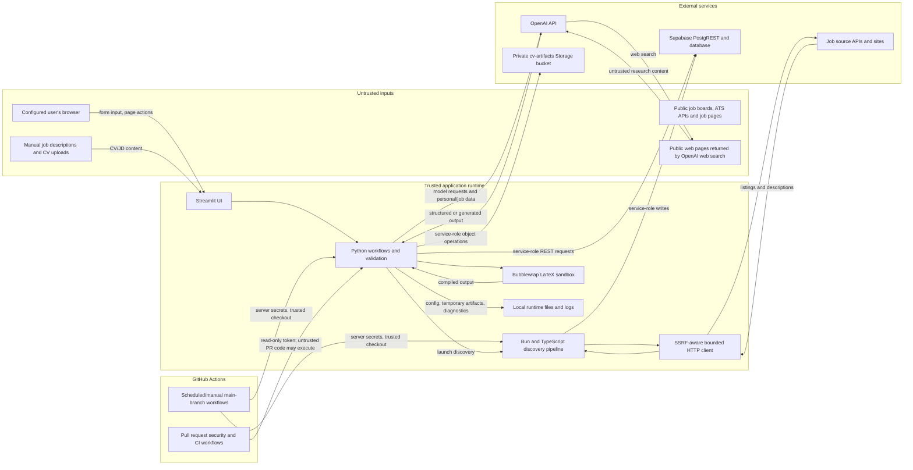

# Security threat model

This document describes the code in this public portfolio snapshot. Candidate
examples are synthetic; no live application secrets or database are configured
here. Deployment and provider settings remain separate operator decisions.

This document records the application's security-relevant assets, flows, threats,
controls and residual risks as they are verified during Phase 4. It describes
repository evidence, not a live audit of the production Supabase, OpenAI, source
provider, GitHub, hosting or backup configuration. Unknown external retention and
operational settings are labeled as unverified.

## Phase 4.1: asset and data inventory

**Status: inventoried from code, active migrations and existing operational docs.**
The application is documented as a personal, server-configured workspace. It
resolves one configured AI_JOB_SEARCH_USER_ID; this is not a public sign-in or
multi-user frontend. The Streamlit server uses a Supabase secret key, so its
server configuration and reachable instance are high-trust components.

| Asset | Where it enters and is stored | Sensitivity and owner | Retention and deletion evidence |
| --- | --- | --- | --- |
| Supabase, OpenAI and job-source credentials; configured user UUID | Local .env/Streamlit server configuration and GitHub Actions repository or environment secrets. Values are read by the server or named workflow steps. | **Restricted.** Deployment/repository operator owns credentials; the configured user UUID identifies the data subject. | No credential-rotation or expiry schedule was found in repository documentation. .gitignore excludes .env*; that does not protect a value already committed. Gitleaks checks repository history and changes. GitHub secret lifetime/settings require a separate configuration review. |
| Original CV, CV versions and extracted candidate evidence | User uploads LaTeX through Profile. The source file is placed in the private cv-artifacts Supabase Storage bucket. cv_versions stores object paths and metadata; candidate_profiles.profile_json stores versioned parsed evidence and an input digest. | **Restricted personal data.** The configured user owns the CV and profile; the deployment operator administers storage and database access. | Base CV rows have no expiry (expires_at and artifact-deletion timestamp must be null). Candidate profile generations are historical snapshots. Row deletion follows the applicable database relationships; Storage objects are outside PostgreSQL cascades and need separate cleanup. No general base-CV deletion or storage-purge procedure was found. |
| Search preferences and eligibility/profile settings | Entered in Profile/Settings and stored in search_profiles, user_preferences, and user-scoped verification/override tables. Preferences are also snapshotted in search-run records. | **Sensitive personal data.** The configured user. Preferences can reveal location, work authorization, languages, seniority and career intent. | User-scoped rows cascade where their foreign keys reference auth.users; no time-based expiry was found. Historical search snapshots can persist until their rows are removed. |
| Job listings, job descriptions, source URLs and discovery activity | Acquired from job boards/ATS sources or entered as a manual job/JD. Persisted in jobs, search-run associations, reviews, assessments, summaries and optional candidate traces. A manual JD has an owner and digest. | Public listing fields are usually **low sensitivity** by themselves. Manual JDs may be confidential; saved listings, queries and review history reveal the user's career interests and are **sensitive personal activity**. | No general expiry for jobs, assessments, applications or summaries was found. Candidate-level tracing is opt-in, bounded, and documents a 30-day retention target with bounded cleanup in the [operations guide](discovery-candidate-tracing.md). That retention applies to traces, not the rest of discovery history. |
| Applications and interview records | Application status, applied/terminal dates, notes and submitted-CV reference are in applications. Interview type, date, interviewer details/notes, frozen source_context, CV provenance and preparation packs are stored in interview_preparations and interview_preparation_packs. | **Restricted personal data.** Includes employment history, private notes, named interviewers, role context and generated preparation content. The configured user owns it. | Records are user-managed; no time-based expiry was found. Database user deletion cascades the interview rows, while application deletion is restricted when preparations reference it. A copied CV artifact is stored separately; the interview guide explicitly requires operator cleanup of interview-preparations/<user-id>/ Storage objects when removing a user. |
| Tailored CV source/PDF artifacts | Generated from CV/profile and job data, stored as private Storage objects, with paths/lineage in cv_versions. | **Restricted personal data.** The configured user; deployment operator controls the service credential. | matching/tailored_cv_expiration.py defines 40 days from creation, or 40 days after a terminal application state; active application states have no deadline. However, repository search found the cleanup function definition but no caller that runs the general expiry cleanup. Therefore automatic enforcement of this policy is **unverified**. A separate dashboard action cleans artifacts for archived jobs only. |
| AI requests and generated content | OpenAI calls appear in CV parsing, job evaluation/matching, CV tailoring, gap recommendations/generalization, manual-JD evaluation and interview-pack generation. Requests can include CV text/PDF, candidate evidence, job requirements/descriptions or interview context. Some structured outputs are persisted as assessments, profiles or preparation packs. | **Restricted when personal CV/profile/application material is included.** The configured user is the data subject; OpenAI is an external provider for those calls. | Exact per-feature payloads and accepted outputs are documented in task 4.5. Repository code does not establish provider-side retention, training, processing-region or logging settings; the operator must verify those account settings. |
| Local personal inputs, caches, reports and generated documents | Local checkout/runtime may contain ignored .env*, job_search_tracker.csv, job history and scraper caches, company research, CV inputs, application/interview documents, generated reports and diagnostics. Patterns are listed in .gitignore. | **Sensitive to restricted personal data.** The workstation/deployment operator and configured user. | The repository prevents ordinary Git tracking for listed paths; it does not encrypt local disks, control backups, or set local deletion schedules. Those host and backup settings are unverified. |
| Security and operational evidence | CI logs show test outcomes; local scanner/audit reports go under ignored .diagnostics/. Discovery traces may include company/title/source identifiers and URLs. | Logs and reports should be treated as **sensitive operational data** because paths, source activity or identifiers may remain even when secrets are redacted. | Secret-scanning reports are local and not uploaded as artifacts. Discovery traces have the separate bounded retention described above. General CI/log retention is governed by GitHub or hosting configuration and was not inspected in this inventory. |

### Boundaries and unknowns recorded for later tasks

- The server-side Supabase secret key has broad database/storage privileges. The
  frontend chooses a server-configured owner; this deployment model should not be
  described as user authentication. The boundary and code checks are mapped in
  tasks 4.2–4.4; deployment ingress remains unverified and is an open A1 action.
- A private bucket setting and user-scoped database rows do not by themselves prove
  Storage API authorization or account-wide erasure. The existing database suite
  explicitly does not exercise hosted Storage/Auth APIs.
- The 40-day tailored-artifact expiry appears to have no general cleanup caller.
  Treat artifact deletion as an open operational question until a scheduled or
  explicit invocation is identified and verified.
- Repository evidence cannot establish the real deployment's access controls,
  backups, provider retention, logging settings or secret rotation. These require
  configuration evidence from the responsible operator; no live account settings
  or private user records were inspected for this inventory.

Evidence reviewed: [technical guide](technical-guide.md), [active migrations](../supabase/migrations/),
[Profile upload and storage workflow](../ui/profile_data.py), [Supabase REST client](../matching/candidate_profile_persistence.py),
[tailored artifact expiry logic](../matching/tailored_cv_expiration.py),
[interview preparation design](interview-prep-phase1.md),
[preparation pack design](interview-prep-phase2.md),
[trace retention guide](discovery-candidate-tracing.md), and [Git ignore
rules](../.gitignore).

## Phase 4.2: entry points and trust boundaries

**Status: mapped from repository code, workflows and active migrations.** This
map describes intended code paths. It does not verify the deployed Streamlit
ingress, network policy, provider account settings or live credentials.

| Boundary / entry point | Data crossing it | Authentication and privilege | Code-backed control and remaining assumption |
| --- | --- | --- | --- |
| Browser to Streamlit | Profile settings, uploaded LaTeX CV, manual jobs/JDs, application notes and page actions | No application login or browser-supplied identity is implemented in this repository. The app selects `AI_JOB_SEARCH_USER_ID` from server configuration, with a single-active-CV fallback. | `resolve_application_user_id` does not accept query/widget identity. The deployment must protect network access and bind this personal app to its intended user; ingress controls are unverified. |
| Streamlit/Python to Supabase | User-scoped records, CV/profile data, applications, interview content and private object operations | `SupabaseRestClient` sends `SUPABASE_SECRET_KEY` as both API key and bearer token. This is a privileged server credential that bypasses ordinary RLS protections. | Queries and mutation helpers filter/check the configured user; database constraints/RLS provide additional controls for browser roles. Application filters are not a substitute for least-privilege credentials. Hosted Auth/PostgREST/Storage enforcement is not demonstrated by repository tests. |
| Python to OpenAI | Feature-dependent CV/profile evidence, job requirements/descriptions, manual JD text and interview context; some interview-pack paths can attach CV text or PDF | Provider API key is server-side. No browser credential is involved. | Calls originate from explicit app workflows. Exact per-call payloads are in task 4.5; deterministic response-validation and side-effect checks are task 4.6. Provider retention/account settings are unverified. |
| Python to LaTeX compiler | User CV source and generated tailored-CV LaTeX | Local subprocess with no application secrets passed into the sandbox. | Bubblewrap unshares namespaces, disables networking, restricts filesystem/environment and applies resource limits; compilation fails closed if isolation tools are unavailable. |
| Discovery pipeline to job sources | Search configuration, source/API credentials, HTTP requests; public listing and detail-page content returns | Provider-specific API tokens are passed by server environment where required. Public pages generally need no app identity. | `tools/safe_http.ts` vets destinations, pins resolved addresses, validates redirects and bounds response size/decompression. Retrieved content remains untrusted. |
| GitHub Actions manual application jobs | Trusted source checkout, configured Supabase service key, user UUID and selected source API credentials | The public copy has no scheduled application writes and no deployment secrets. A user who configures and manually runs the jobs supplies credentials through the `Job search` environment; jobs check `github.ref == 'refs/heads/main'`. | Workflows have `contents: read`, pinned actions and bounded runtime. A compromised trusted branch or runner can access configured secrets. The portfolio configuration has no live database target. |
| GitHub Actions pull-request security jobs | Proposed source code and synthetic test data | Repository token is read-only; no application secrets or production environment are configured for these jobs. | PR code is untrusted and can execute in CI; isolation/no-secret configuration limits impact. Branch protection and required-check settings remain Phase 5. |
| Local checkout and diagnostics | `.env*`, CV/application files, caches, logs, temporary/generated artifacts and scanner reports | Workstation/runtime user and filesystem permissions; no separate application auth layer. | `.gitignore` reduces accidental tracking, and scanner reports redact secrets. This does not provide disk encryption, backup controls or local cleanup; host configuration is unverified. |

The Mermaid diagram and table cover the trust transitions visible in the current
repository: user-controlled input enters a server-side personal app; the app
crosses to model, database/storage and public-source providers; and CI has a
separate trusted main-branch path and untrusted pull-request path. The current
deployment's browser ingress, secret access policy, provider retention, backups
and GitHub environment/branch protection still require configuration evidence.

## Phase 4.3: prioritized abuse cases

**Status: prioritized from the mapped architecture.** Severity is an engineering
priority, not a claim that an attack has occurred. Where a scenario depends on
deployment configuration that was not inspected, the condition is explicit.

| ID / severity | Attacker and trigger | Affected assets and plausible impact | Existing controls and evidence | Residual risk / priority rationale |
| --- | --- | --- | --- | --- |
| **A1 — High, conditional on network exposure** | An unauthenticated person can reach the Streamlit endpoint and submits requests or uses the UI. | The server uses a Supabase service key. An exposed app could let the visitor read or change the configured user's CV, profile, job history, applications and interview records; bugs in the app could expose the key's broader database/storage privileges. | Repository code uses a server-configured user ID rather than a user-supplied ID; user-scoped access helpers and database authorization regressions exist. See [user context resolution](../ui/profile_data.py), [persistence client](../matching/candidate_profile_persistence.py) and [database authorization tests](../tests/security/test_database_authorization.py). | No login is implemented in this repository. The hosting/network access controls were not inspected. Because the impact includes restricted personal data and privileged writes, verify ingress is private and limited to the intended user before deployment. |
| **A2 — High** | A malicious job board, ATS response, or person controlling a retrieved page supplies a URL, redirect, DNS answer, oversized/compressed response, or hostile content that the discovery pipeline fetches. | The discovery runner, its credentials, local resources and persisted job data could be exposed to SSRF, resource exhaustion, or poisoned records. | `tools/safe_http.ts` vets destinations, pins DNS answers, revalidates redirects and bounds response/decompression; synthetic cases run in [HTTP privacy tests](../tests/safe_http.test.ts) and the [security regression workflow](../.github/workflows/security-regressions.yml). | Parser or fetch paths outside the shared safe client, provider changes, and undiscovered URL forms can leave gaps. Continue routing all untrusted fetches through the bounded client; tests do not prove all remote behavior safe. High because the pipeline contacts untrusted destinations while holding database credentials. |
| **A3 — High** | A malicious CV, job description, public web page, or other retrieved text contains prompt-injection instructions or fabricated evidence that is included in an AI request. | CV/profile evidence, job-fit assessments, tailored CVs or interview packs may be corrupted; private CV/profile material is sent to an external model for features that need it. A misleading result could cause a poor application or cause generated content to repeat supplied details. | Several prompts explicitly treat supplied documents/web pages as untrusted evidence; interview-pack output has a typed schema, source/evidence identifiers and bounded inputs. See [interview pack generation](../matching/interview_preparation_pack.py) and [pack tests](../tests/test_interview_preparation_pack.py). | Typed/schema/reference validation rejects malformed structures and unknown IDs, but semantic truth and prompt-injection resistance are not guaranteed or evaluated. Provider retention remains unverified. High because sensitive personal data and consequential generated content are involved. |
| **A4 — High** | A malicious CV author or compromised/generated LaTeX source uses TeX commands to read files, access the network, consume resources, or persist outside the compile directory. | Host files, credentials, runtime availability and generated CV artifacts. | Compilation uses Bubblewrap namespace isolation, a restricted filesystem/environment, no network and resource limits, and fails closed without required tools. Evidence is in [LaTeX sandbox](../matching/latex_sandbox.py), [artifact safety tests](../tests/test_cv_artifact_safety.py) and the CI workflow. | Isolation depends on supported host/kernel behavior and the sandbox configuration staying intact. A compromised host or sandbox escape remains outside the test guarantee. High because arbitrary document instructions reach a compiler process. |
| **A5 — High** | A contributor submits a malicious pull request that executes code in CI, or an attacker compromises trusted main-branch code, a dependency, or a runner used by a secret-bearing workflow. | Repository contents, CI tokens and, if an operator later configures the manual application jobs, source API credentials, user data and a Supabase service key. | Security workflows use read-only repository permissions and no application secrets; manual application workflows run from `main`, pin actions and scope secrets to named jobs/environment. See [discovery workflow](../.github/workflows/job-discovery.yml), [dependency workflow](../.github/workflows/code-dependencies.yml) and [security regression workflow](../.github/workflows/security-regressions.yml). | PR code still executes and can affect its own job; configured `main` jobs would receive powerful secrets. Branch and environment protections must be verified before adding any application secrets. High because compromise could cross from code execution to personal data and external credentials. |
| **A6 — Medium** | An operator accidentally commits a credential, or an attacker obtains the developer workstation/runtime or a local diagnostics file. | Supabase/OpenAI/source credentials, CVs, application records, caches and local logs. | `.env*` and personal artifacts are ignored; Gitleaks scans fetched history, staged content and the worktree, with synthetic regression cases in [secret-scanning tests](../tests/test_secret_scanning.py). | Ignore rules and scanning cannot protect already exposed credentials, ignored local files, backups, deleted remote refs, or unknown secret formats. Rotate any confirmed leak and review workstation/backup controls. Medium because controls detect repository leaks but local host security is unverified. |
| **A7 — Medium** | A user retries an action after a timeout or a client repeats a request, causing a persistence operation to be replayed; alternatively, a caller supplies an ID belonging to another user. | Duplicate interview records/artifacts, incorrect application state, or cross-user access to CV and application data. | User-owned operations include owner filters/checks; interview preparation creation uses idempotency keys and cleanup/recovery logic. Evidence: [interview preparation tests](../tests/test_interview_preparation.py), [application lifecycle tests](../tests/test_application_lifecycle.py), and [database authorization tests](../tests/security/test_database_authorization.py). | Service-role access makes application-level ownership checks critical; new routes or mutation helpers can omit them. Hosted Storage/Auth authorization is not covered by the disposable database suite. Medium: mitigations exist, but a missing filter has material privacy impact. |
| **A8 — Medium** | A routine cleanup is missed, a deletion only removes a database row, or a local/hosted backup is accessed outside its intended lifecycle. | Base and tailored CV objects, copied interview CVs, generated reports and long-lived application history. | Private bucket metadata and user-scoped object paths are used; some interview cleanup instructions and candidate-trace retention are documented. | General tailored-artifact cleanup has no identified caller; Storage objects are not removed by database cascades; backup and provider retention are unverified. Medium because this is primarily a persistence/privacy exposure over time, with no repository proof of complete erasure. |

The model itself is not treated as an attacker-resistant control. Cases A1 and A5
are operational trust assumptions; A2, A4, A6 and A7 have code-level controls
with residual gaps; A3 and A8 need further boundary/control work.

## Phase 4.4: threat-to-control map and gaps

**Status: mapped to repository controls and CI evidence; application and host
risks remain open as shown below.** The named role is the follow-up owner. CI
verifies only the listed code behavior; it cannot prove external hosting or
account configuration.

| Case | Implemented control and verification | Status and follow-up owner/action |
| --- | --- | --- |
| **A1 — app exposure** | The [Streamlit entry point](../app.py) fails closed without server Supabase configuration. [Identity resolution](../ui/profile_data.py) uses server configuration and defaults Streamlit to loopback in [binding tests](../tests/test_streamlit_local_binding.py). | **Open operational requirement — Deployment operator:** before exposing the app beyond the local machine, provide evidence of private ingress/authentication restricted to the intended user. The repository does not implement login, and the current test only checks the default bind address. |
| **A2 — untrusted fetch / SSRF** | [Safe HTTP client](../tools/safe_http.ts) validates destinations and redirects and bounds bodies. [HTTP tests](../tests/safe_http.test.ts) cover special/private IPs, DNS pinning, redirects and decompression limits; the [security workflow](../.github/workflows/security-regressions.yml) requires these cases without skips. | **Implemented with coverage boundary — Application maintainer:** keep all untrusted fetches on the shared client and add a regression case whenever a new fetch path or URL form is introduced. Audit direct network calls during future source additions. |
| **A3 — prompt injection / misleading AI output** | [Interview-pack generation](../matching/interview_preparation_pack.py) labels supplied content as untrusted, applies bounded input and typed output, and validates source/evidence identifiers. Its [offline tests](../tests/test_interview_preparation_pack.py) exercise explicit consent, prompt inputs, output validation and refusal/incomplete responses. | **Partial; semantic resistance remains unverified — Application maintainer:** keep the deterministic schema/reference/side-effect checks in place. If behavioral evaluation is introduced, follow task 4.7's synthetic-set policy; do not treat prompt wording or evaluation scores as hard controls. **Deployment operator:** verify provider retention configuration. |
| **A4 — hostile LaTeX** | [Sandbox command](../matching/latex_sandbox.py) restricts environment/filesystem/network and fails closed. Hosted [CI](../.github/workflows/security-regressions.yml) requires command-policy and fail-closed cases; four real compiler-isolation cases in the [artifact-safety tests](../tests/test_cv_artifact_safety.py) and [tailoring tests](../tests/test_tailored_cv.py) passed locally on 2026-11-11 but cannot run on GitHub-hosted Ubuntu because it denies the required network namespace setup. | **Implemented with host and CI coverage boundaries — Application maintainer:** preserve sandbox flags and fail-closed behavior; re-run the full suite on a trusted, namespace-capable host before release and after compiler, Bubblewrap, or sandbox changes. Host compromise and sandbox escapes remain outside these tests. |
| **A5 — malicious PR or compromised trusted workflow** | [Security regression CI](../.github/workflows/security-regressions.yml), source/dependency CI, dependency review and [CodeQL](../.github/workflows/codeql.yml) use read-only repository contents and no application secrets. CodeQL alone has `security-events: write` to upload findings. The public [discovery workflow](../.github/workflows/job-discovery.yml) is manual-only and has no configured secrets. GitHub branch protection requires PRs and nine GitHub Actions checks, applies to administrators, requires up-to-date branches and linear history, and disallows force pushes/deletion. The `Job search` environment is restricted to `main` and requires a manual reviewer action. | **Partially mitigated — Repository administrator:** keep the branch rule and environment restriction enabled. The branch rule requires zero independent approvals; CODEOWNERS suggests the owner but cannot provide independent review in this single-owner repository. Do not add production secrets until deployment controls and private ingress are reviewed. |
| **A6 — credential or local-data exposure** | [Gitleaks workflow](../.github/workflows/secret-scanning.yml) scans fetched history and current changes; [synthetic scanner tests](../tests/test_secret_scanning.py) verify historical, staged and ignored-file handling and redaction. `.gitignore` excludes common local secrets and personal files. | **Implemented for repository scan scope — Repository operator:** rotate credentials after any confirmed exposure. Workstation files, backups and host compromise are outside the scanner; verify endpoint protection and backup access under the operator's normal controls. |
| **A7 — replay or cross-user access** | Owner-scoped query/mutation helpers are covered by [interview preparation tests](../tests/test_interview_preparation.py) and [application lifecycle tests](../tests/test_application_lifecycle.py). The disposable migrated-database suite tests browser-role denial, ownership constraints and idempotent RPC identity in [database authorization tests](../tests/security/test_database_authorization.py). | **Implemented with privileged-client residual risk — Application maintainer:** every new endpoint/mutation must retain an owner filter and negative cross-user test. Database CI does not exercise hosted Storage/Auth APIs; keep that boundary explicit unless separately tested. |
| **A8 — stale artifacts / incomplete deletion** | Private bucket metadata and some user-scoped paths are established in migrations. [`tailored_cv_expiration.py`](../matching/tailored_cv_expiration.py) defines the general expiry rules; repository search found no caller of its cleanup function. | **Open implementation and operational gap — Application maintainer:** identify and add a scheduled or explicit invocation for general expiry, then test database and Storage deletion together. **Deployment operator:** verify backup/provider retention and document account-erasure handling. Until then, do not claim automatic expiry or complete erasure. |

The current evidence establishes several useful controls, but it does not mean
all threats are mitigated. A1 and A8 require action before claiming protected
deployment or automatic erasure; A3 and A5 remain partial pending later Phase 4
work and Phase 5 enforcement. The specific next steps above remain visible until
evidence closes them.

## Phase 4.5: AI data boundary

**Status: model call sites and payloads inventoried from current Python code.**
All listed calls use the OpenAI API through server-side SDK clients configured
from `OPENAI_API_KEY`; the interview adapter uses the same environment-based SDK
configuration. Repository code does not establish account-level retention,
training, processing-region, or provider log settings. Those settings remain
unverified and should be checked by the operator.

| Workflow and user action | Data sent to OpenAI | Accepted response and application effect |
| --- | --- | --- |
| **CV parsing** — Profile page's **Save & Parse** action after `.tex` validation | Full uploaded LaTeX source (upload validation caps it at 2 MiB), enclosed as source data with an instruction not to follow embedded instructions. | Structured `ExtractedCandidateProfile`; local normalization and invariant checks follow. A successful result is persisted as a candidate profile and activates the new CV/profile generation. An invalid provenance response can trigger one retry with the same CV input. No model tools are enabled. |
| **Job requirement interpretation** — evaluation workflow (`matching/job_evaluation.py`) | Job title/company/description and description kind, candidate profile JSON and search profile JSON. These include CV-derived evidence and job preferences. | Structured `StructuredJobInterpretation`; code validates IDs, normalizes requirements and computes derived weights/scoring outside the model. The model is instructed not to obey job-text instructions. No model tools are enabled. |
| **Holistic Fit, including a manually entered JD** — evaluation workflow, including the manual-JD evaluation route | A projected verified job title and description plus a reduced candidate projection: summary, current role, seniority, experience, roles, capabilities, tools/platforms, certifications and languages. Manual JD text is untrusted job evidence in the same job-description field. | Structured `HolisticFitOutput`; caller persists the assessment and job snapshot through the user-scoped application workflow. No model tools are enabled. |
| **Tailored CV** — user requests generation for a selected job | Base CV text, a reduced candidate-profile projection and a reduced job projection, including job requirements/evidence. | Structured `TailoredCVOutput` is validated, rendered as LaTeX, compiled in the local document sandbox, then the source/PDF artifacts and lineage are saved. No model tools are enabled; the model does not directly write to storage or run the compiler. |
| **Gap generalization** — explicit **Analyze gaps** action when source gaps need category assignments | Batches of source-gap IDs, company, role title and gap text, plus existing category names/descriptions. This is assessment history, but the current function does not send the full CV/profile. | Structured `GapGeneralizationOutput`; code checks every source ID is assigned once and rejects unknown/omitted IDs before saving mappings. A correction request may include the previous structured output and validation error. No model tools are enabled. |
| **Gap improvement plans** — same explicit **Analyze gaps** action | Candidate improvement evidence and up to five recurring gap categories, with category descriptions, percentages and up to eight role/gap examples per category. Candidate evidence is derived from the active profile. | Structured `GapImprovementPlanBatch`; code rejects unknown, duplicate or missing category keys. Results are shown/saved in the UI session. No model tools are enabled. |
| **Interview-pack public research** — explicit generation after the user confirms the consent checkbox | Company and role title only, each capped at 300 characters. The request enables OpenAI `web_search`, capped at three tool calls; retrieved pages are untrusted. | Research text is capped at 18,000 characters and validated HTTPS citations are kept (up to 30); this output becomes input to the next call. This first call does not include candidate profile or CV data. |
| **Interview-pack generation** — same user-confirmed generation action | Structured prompt content includes the frozen job description, company/title, interview stage, interviewer role/notes, Fit assessment, candidate profile snapshot/evidence identifiers, research text, allowed citation IDs and limitations. If a saved submitted CV artifact is confirmed and available, the request also includes the PDF (bounded to 2 MiB) or bounded text. The UI checkbox states that saved job and candidate context will be sent to OpenAI. | Typed `PreparationPack`; code validates candidate-evidence and company-source references and persists the pack. The model call has no tools. The one optional web-search tool belongs only to the separate research call. |

For the listed workflows, prompts mark CV/job/web material as evidence rather
than instructions, and model responses cannot independently call application
database, Storage, shell, email, or arbitrary network operations. The one
provider-side capability is bounded web search in the public-research call.
Application code initiates persistence and compilation after it receives and
validates output. This limits direct side effects; it does **not** guarantee that
a model will resist prompt injection, that generated content is accurate, or
that structured output is harmless. In particular, generated tailored-CV LaTeX
is untrusted input to the separately sandboxed compiler.

CV parsing, job interpretation/Fit, tailoring and gap analysis are performed
after the user takes their corresponding app action, but their UI does not show
the same explicit data-transfer consent checkbox used for interview packs. The
model calls are initiated by those corresponding workflows, not by the model
itself. Confirm whether this action-based notice is sufficient for the intended
deployment before broadening access; ingress must remain private under the A1
assumption.

OpenAI response IDs, model names and usage counts may be captured as diagnostics
or usage metadata; generated profiles, assessments, tailored artifacts, gap
plans and interview packs may be persisted as described above. The repository
does not establish whether provider-side request/response storage, training,
regional processing or log retention is enabled. The operator must verify those
account settings and document any applicable retention choice. Task 4.6 adds
deterministic parsing, validation, and side-effect checks; these do not treat
prompt wording or model behavior as a security guarantee.

## Phase 4.6: deterministic AI safeguards

**Status: implemented and included in the required offline security regression
suite.** These checks use fake model clients and synthetic data; no live model
credential is required.

- Retrieved job descriptions and CV input are passed as evidence alongside
  prompt-level untrusted-data instructions. [Fit tests](../tests/test_holistic_matcher.py)
  and [CV parser tests](../tests/test_cv_parser.py) assert the exact hostile text
  and structured response contract sent to a fake model. These tests verify the
  application's request shape, not that a real model will obey the instruction.
- `HolisticFitOutput`, `ExtractedCandidateProfile`, `PreparationPack`, and
  `TailoredCVOutput` reject malformed, unexpected or schema-invalid responses.
  Interview-pack fields have explicit count/text limits; tailored LaTeX output
  is capped at 100,000 characters before compilation. A rejected tailoring
  result is tested to cause no compile or Storage/database write in
  [tailored-CV tests](../tests/test_tailored_cv.py). An oversized interview-pack
  field is rejected in [pack tests](../tests/test_interview_preparation_pack.py).
- Manual job descriptions are limited to 30,000 characters before writes or
  model calls. [Manual-JD tests](../tests/test_manual_jd.py) verify the limit,
  reject-before-side-effect behavior and the structured Fit request.
- The interview UI requires an explicit consent checkbox plus button action;
  [UI tests](../tests/test_interview_prep_ui.py) prove there is no generation
  call before both. The model generation request has no tools; bounded
  `web_search` is only used by the separate public-research request.
- Invalid or unknown candidate/source references are rejected before an
  interview pack is saved, and invalid gap assignments are rejected before
  persistence. Evidence is in [interview-pack tests](../tests/test_interview_preparation_pack.py)
  and [gap-generalization tests](../tests/test_gap_generalization.py).
- [The regression runner](../scripts/security/run_regressions.py) requires the
  key AI cases to execute with zero skips in the security workflow's Python
  job. The generated JUnit report must contain each named required case.

These are deterministic guarantees about validation and application side
effects. They do not guarantee accuracy, prompt-injection resistance, or
provider retention behavior. Output size limits are schema-specific rather than
a universal cap across every model response; expanding those limits requires a
workflow-specific need and a corresponding test. The tests intentionally do not
score whether a model resists adversarial instructions.

## Phase 4.7: model evaluations versus security guarantees

**Status: distinction and reevaluation policy documented.** The repository has
no model-behavior evaluation corpus, scoring harness, or published model-resistance
result. The fake-client regression tests in task 4.6 are deterministic tests of
application requests, validation and side effects; they are not evaluations of
the live model.

The following outcomes are code-enforced and may be reported as security
controls: schema/field validation, bounded input/output cases where implemented,
owner and source-identifier checks, explicit workflow consent, absence of
unrequested model tools, and no persistence/compilation after invalid output.
The following remain probabilistic product behavior and must not be claimed as
guaranteed: obeying prompt-injection instructions, factual accuracy, completeness,
relevance, and the quality of inferred recommendations or interview preparation.

If a model-behavior evaluation is introduced, the application maintainer should
create a versioned synthetic adversarial set covering CV, job-description, and
web-research instructions; factual-support and citation behavior; and expected
refusal/uncertainty cases. Do not use private CVs or live user records in the
evaluation corpus. Record the dataset, prompt, model/provider version, date,
scoring rubric, aggregate results and reviewer notes. Re-run before deploying a
change to the model, prompt, output schema, or enabled tool set, and quarterly
while an evaluation is maintained. Keep evaluation scores advisory: they never
replace deterministic schema, authorization, consent, sandbox, or side-effect
checks. No such evaluation is currently run, so this document makes no claim
about model resistance or accuracy.

## Phase 4.8: review and publication

**Status: reviewed against the current repository and published.** The flow map,
abuse cases, controls, test names, CI workflow configuration and AI call sites
were rechecked. Repository links in this document resolve. CI evidence is linked
at each applicable control; the public repository's required-check and
branch-protection settings were verified through the GitHub API on 2026-11-11.

The material open items are intentionally retained: A1 requires verified private
deployment ingress because the app has no login; A3 has no model-behavior
evaluation and makes no resistance/accuracy claim; A5 still requires deployment
secret and ingress review before enabling application workflows; A8 needs a
caller for general tailored-artifact expiration plus deletion/backup verification.
These are risks and follow-up actions, not mitigations. The README links here for
reviewers who want the detail behind its concise security summary.
