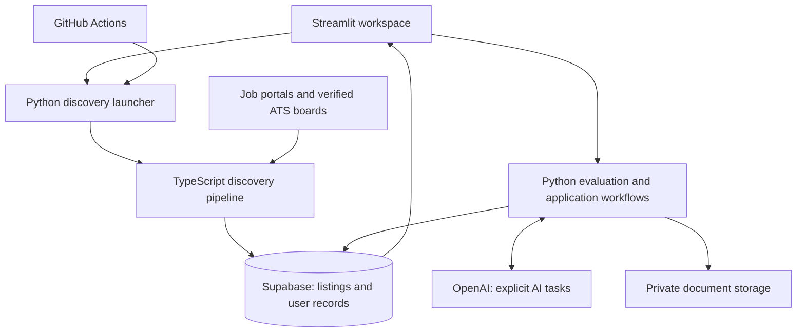

# Technical guide

[← Project overview](../README.md)

AI Job Discovery connects job acquisition, evidence-based evaluation, and application tracking in a personal Streamlit workspace. This guide explains the design choices, points to their implementation, and describes what a separate deployment needs.

## Architecture

The system separates three concerns: collecting job facts, evaluating candidate evidence, and recording user decisions. Discovery can run without an AI evaluation; changing search preferences does not change what the candidate can claim as experience.



- **Streamlit and Python** handle review, candidate evidence, evaluations, CV generation, and interview preparation.
- **TypeScript and Bun** run source adapters, normalize listings, check eligibility, and persist discovery results.
- **Supabase** holds durable records and private document artifacts. Short-lived Streamlit caches support navigation; they are not the source of truth.
- **GitHub Actions** invokes the same [discovery launcher](../scripts/run_dashboard_discovery.py) as the local app. A separate workflow refreshes dashboard summaries.

## Decisions that shape the implementation

### Separate preferences from evidence

`SearchProfile` describes desired roles, locations, work models, seniority, languages, and employment types. `CandidateProfile` describes capabilities supported by CV evidence.

The [candidate model](../matching/candidate_profile.py) validates evidence strength and references. For example, a skill listed under fundamentals cannot claim production ownership. Fit evaluations keep score, evidence coverage, confidence, and gaps distinct; assessment records retain the profile version used.

This makes the reasoning inspectable, but does not guarantee that an AI assessment is correct. Users still review evaluations and generated documents.

### Preserve uncertainty in discovery

The [discovery pipeline](../tools/generic_discovery.ts) selects sources using configuration, search preferences, and available credentials. It normalizes observations, deduplicates listings, checks availability and preferences, and enriches incomplete descriptions within a bounded request budget.

Verified company hiring boards use [ATS adapters](../tools/ats_job_ingestor.ts). Complete, partial, failed, and rate-limited results are distinct outcomes. An absent posting can provide closure evidence only when the relevant board snapshot is complete; a failed crawl does not prove a job has disappeared. Unresolved eligibility evidence can remain available for user review.

Source capability definitions live in [`tools/source_capabilities.ts`](../tools/source_capabilities.ts), and individual search CLIs live under [`.agents/skills/`](../.agents/skills/). Provider availability and registry size depend on configuration and runtime data, so neither is a fixed product guarantee.

### Keep application history meaningful

Shared listing facts are separate from each user's review decisions, preferences, and application state. A listing can be reviewed or archived before becoming an application; discovery does not submit applications.

Tailored CVs retain version context and can be compared with the base CV. Interview rounds preserve source snapshots, including candidate and assessment context. When the exact submitted CV is not established, the user must confirm it or retain an explicit missing-context state.

Interview preparation also supports explicitly generated preparation packs. Opening a saved round does not generate new AI output. The [source snapshot design](interview-prep-phase1.md) and [preparation pack design](interview-prep-phase2.md) document provenance, retry handling, citations, and limitations.

### Bound reads and measure traffic

Jobs and Applications use paginated dashboard summaries, with longer assessment details loaded on demand. [Page loading](../ui/page_loading.py) uses short-lived, revision-aware caches. Summary rebuilds reuse profile inputs, and observation-only updates are distinguished from changes that invalidate summary content.

The REST clients emit request metrics without response content or credentials. To summarize captured logs:

```bash
python scripts/postgrest_egress_report.py /path/to/app.log /path/to/discovery.log
```

The report groups request counts, errors, and response-body bytes. These measurements help compare workloads; they are not equivalent to provider-billed egress and do not establish a benchmark by themselves.

### Isolate generated document compilation

Generated LaTeX is treated as untrusted input. The [compiler sandbox](../matching/latex_sandbox.py) uses Bubblewrap, network isolation, an allowlisted environment, and resource limits. If the sandbox cannot run, compilation fails without an unsandboxed fallback.

Artifact writes use distinct attempt paths and reconcile uncertain persistence outcomes before cleanup. See [CV artifact safety](cv-artifact-safety.md) for installation requirements, recovery behavior, and isolation tests.

## Local setup

This is a personal, server-configured application, not a public multi-user service or a credential-free demo. A fresh checkout needs a database, an owner identity, and profile data before the full workflow is usable.

### Prepare the deployment

1. Use Python 3.12 (recommended) and Bun for discovery. PDF compilation additionally needs Linux, TeX, Bubblewrap, and the dependencies described in [CV artifact safety](cv-artifact-safety.md).
2. Prepare your own Supabase project with the active [database migrations](../supabase/migrations/), a user identity for the application records, and private `cv-artifacts` storage. The [migration history](supabase-migration-history.md) explains the baseline and archived SQL; archived migrations are historical material, not an additional migration chain to replay.
3. Keep the Supabase secret key in trusted server configuration. The app selects its owner from server configuration rather than a browser-controlled user selector; that is not a public sign-in flow.

Database provisioning is a separate setup step. Starting Streamlit does not create the required schema, owner identity, or storage configuration.

### Install and configure

From the repository root:

```bash
python3 -m venv .venv
source .venv/bin/activate
pip install --require-hashes -r requirements-lock.txt
cp .env.example .env
```

Fill in `.env` using your own values:

| Variable | Purpose |
| --- | --- |
| `SUPABASE_URL` | Your Supabase project URL |
| `SUPABASE_SECRET_KEY` | Server-side database and storage access |
| `AI_JOB_SEARCH_USER_ID` | Existing user UUID for this app instance |
| `OPENAI_API_KEY` | AI evaluation, CV parsing/tailoring, recommendations, and preparation packs |

Some job sources need additional API credentials and CLI dependencies. Consult the selected source's instructions under `.agents/skills/<source>/` and the [workflow configuration](../.github/workflows/job-discovery.yml).

```bash
streamlit run app.py
```

In **Profile**, upload and parse a LaTeX base CV, review the resulting candidate evidence, and save job preferences. Start discovery from **Settings**, then review the saved listings in **Jobs**. AI requests can incur API charges.

### Manual GitHub Actions runs and forks

The public portfolio copy disables automatic discovery and summary writes. The [discovery workflow](../.github/workflows/job-discovery.yml) and [summary-builder workflow](../.github/workflows/dashboard-summary-builder.yml) can be run manually after configuring your own project. The discovery workflow defines request budgets, optional tracing, source credentials, and ATS rotation settings.

A fork needs `SUPABASE_URL`, `SUPABASE_SECRET_KEY`, and `AI_JOB_SEARCH_USER_ID` environment secrets, plus any selected source credentials. Set the `SUPABASE_PROJECT_REF` environment variable to the exact project ref. The jobs reference the **Job search** environment and expect a populated, verified ATS registry in Supabase.

Review the workflows and your environment's branch restrictions before running them. The summary-builder commands require `--expected-project-ref` and an explicit `--allow-production` flag for hosted writes. Adding secrets alone does not make these workflows portable.

## Verification

The [security implementation plan](security-implementation-plan.md) tracks phased
controls, local secret-scan commands, and rollout status.

The repository includes Python and Bun regression tests for evidence rules, discovery, application workflows, caching, and artifact handling. Useful entry points for a code review:

- [Candidate evidence tests](../tests/test_candidate_profile.py): reject inflated ownership and unresolved evidence references.
- [ATS ingestion tests](../tests/ats_job_ingestor.test.ts): exercise adapter responses, incomplete snapshots, and listing identity.
- [CV artifact safety tests](../tests/test_cv_artifact_safety.py): check sandbox boundaries and uncertain-save recovery.
- [Request metric tests](../tests/test_postgrest_metrics.py): check measurements without logging private response content.

```bash
pip install --require-hashes -r requirements-lock.txt
pytest -q
bun test tests
```

Some checks require host sandbox support or explicitly configured disposable local database services. Mocked tests do not prove live provider compatibility or deployed database behavior. The interview preparation guides describe their additional integration requirements.

## Scope and limitations

- Discovery coverage depends on source access, credentials, and the active search profile. Incomplete descriptions and uncertain eligibility require review.
- AI-generated assessments, CV changes, and interview material are assistance, not verified statements about a candidate or employer.
- This server uses privileged credentials for a configured owner. Public multi-user hosting would require an appropriate authentication and authorization design.
- Keep real CVs, application records, credentials, and diagnostic artifacts outside version control. Schema migrations belong in the repository; personal deployment data does not.
